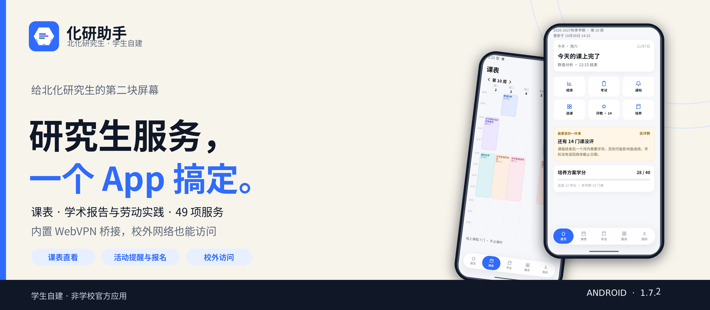
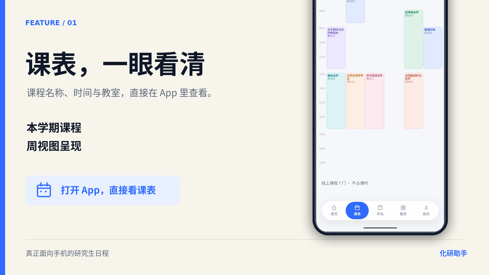
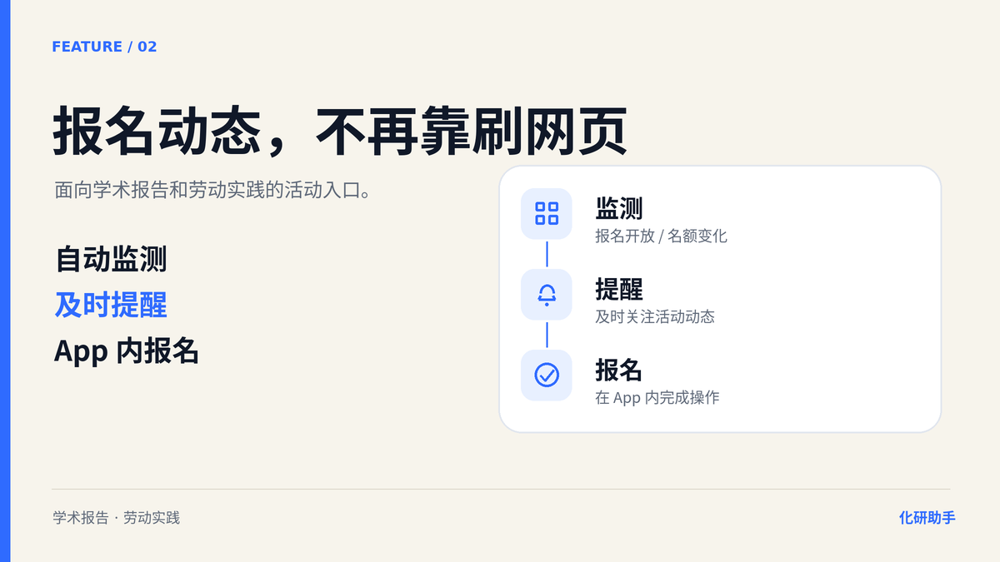
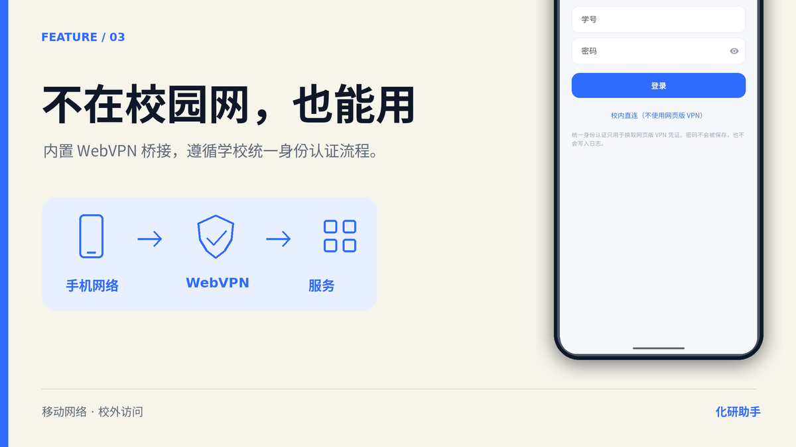
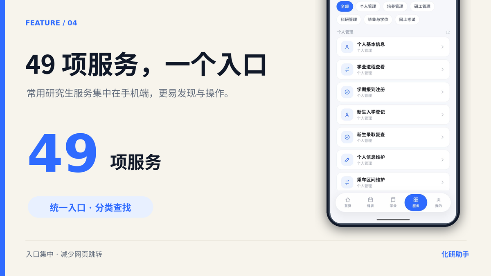
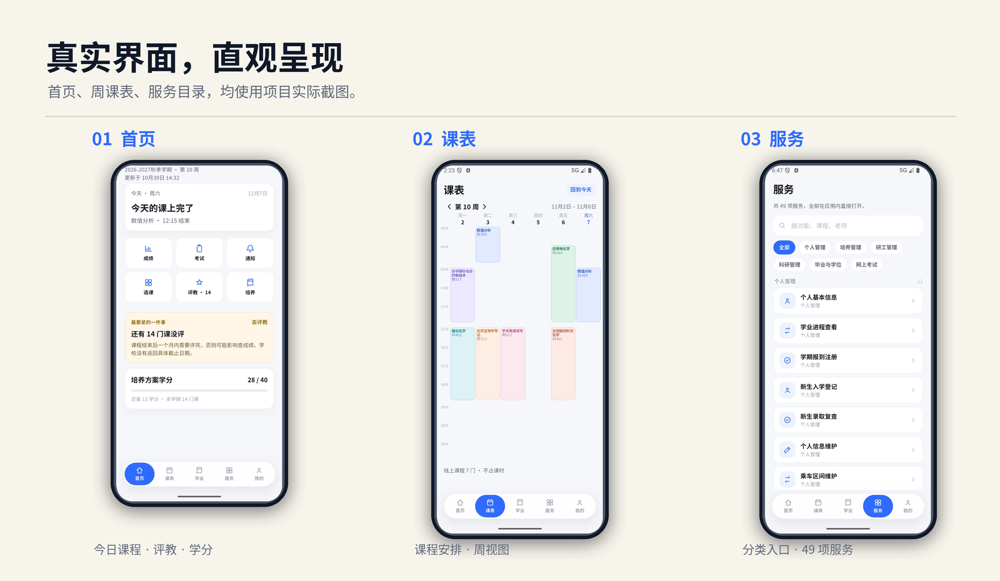

<p align="center">
  
</p>

<p align="center">
  <strong>化研助手</strong> · 北化研究生 · 学生自建
  <br>
  把研究生事务，装进一个 App。
</p>

<p align="center">
  
  
  
  
  
  <a href="https://github.com/JackWPP/buct-graduate-helper/actions/workflows/ci.yml"></a>
</p>

<p align="center">
  <sub>5 Tab：首页 · 课表 · 学业 · 服务 · 我的</sub>
</p>

<p align="center">
  <a href="https://github.com/JackWPP/buct-graduate-helper/releases/latest"><b>下载最新 Android 测试版 →</b></a>
</p>

---

## 为什么做化研助手？

研究生常用服务往往分散在多个网页里，手机上反复寻找、切换入口不够方便；部分场景还需要通过校园网或 WebVPN 访问。化研助手是北京化工大学研究生管理系统的移动增强层，它不重做学校系统，而是把每天要看的课表、成绩、考试、通知和办事入口整理成一部更顺手的手机应用。

- **打开就看今天**：首页直接显示当前教学周、今日课程、下一节课、评教提醒和培养进度。
- **课表像手机应用，不像网页**：周视图、左右滑换周、长课名折行、课程详情、提醒、ICS 分享。
- **49 项服务一个入口**：搜索、分组筛选，点开即用，不跳系统浏览器。
- **原生体验，真能登录**：默认网页版 VPN + 原生统一身份认证（含短信二次认证）；SSO 成功后学号/密码先带入 GMIS 登录页；勾选“保持登录”后密码加密保存，下次只补图形验证码。
- **校外也能访问**：默认走学校网页版 VPN，统一身份认证在应用内完成，不需要额外打开浏览器。
- **选课可以直接完成**：二次确认 + 选课验证码，提交后刷新课表与学分。
- **学术报告 / 劳动实践不再错过**：可报名活动、我的报名、活动详情、报名/取消和独立验证码；登录后自动监测新活动，报名开始/截止前发本地提醒。

## 核心体验

<table>
  <tr>
    <td width="50%"></td>
    <td width="50%"></td>
  </tr>
  <tr>
    <td width="50%"></td>
    <td width="50%"></td>
  </tr>
</table>

## 实际界面

<p align="center">
  
</p>

## 现在能做什么

| 场景 | 体验 |
| --- | --- |
| 看今天 | 首页显示当前教学周、今日课程、下一节课、评教提醒、培养进度 |
| 看课表 | 周视图、左右滑/箭头换周、课程详情、单课提醒、ICS 分享 |
| 看学业 | 培养进度、成绩、已修课程、评教、考试与调课、申请列表 |
| 办事 | 49 项服务扁平目录，搜索 + 分组筛选，全部应用内打开 |
| 登录 | 网页版 VPN → 原生统一身份认证（含短信二次认证）→ 自动带入 GMIS 登录页（只补验证码） |
| 选课 | 筛选、余量/冲突提示、二次确认、选课验证码、提交/退课 |
| 活动报名 | 学术报告 / 劳动实践：可报名、我的报名、详情、报名/取消、自动监测、本地提醒 |
| 离线 | 本机快照缓存；有会话时先显示缓存再刷新 |
| 我的 | 个人资料、培养进度、申请、成绩单、设置、退出登录 |

## 产品状态

| 项目 | 状态 |
| --- | --- |
| 当前版本 | `1.7.2+10` |
| 主线 | Android / Flutter；iOS 共用代码，尚未出包 |
| 业务页面 | 全原生；WebView 仅保留为 WebVPN 认证页兜底 |
| 登录 | 网页版 VPN + 原生统一身份认证（含短信 2FA）+ GMIS 验证码；SSO 会话可静默续签，GMIS 密码可选加密保存 |
| 数据 | 真实 GMIS 接口；快照缓存，登录 Cookie 存系统安全存储 |
| 选课 | 可提交/退课（二次确认 + 选课验证码） |
| 尚未完成 | 活动监测的系统级后台常驻、深色模式、正式 release 签名、iOS 打包、部分复杂服务表单 |

## 快速开始

### Android

```bash
cd app
flutter pub get
flutter test
flutter analyze
flutter build apk --debug
```

debug APK 在 `app/build/app/outputs/flutter-apk/app-debug.apk`。

### 网页预览

```bash
cd web && python3 -m http.server 8899
```

打开 http://127.0.0.1:8899/ 。`web/` 是 390px 设计预览，不是功能主线。

## 仓库结构

| 目录 | 内容 |
| --- | --- |
| `app/` | Android/iOS Flutter 应用，项目主线 |
| `web/` | 390px 可点击设计预览与网页回归参照 |
| `docs/` | 产品、架构、开发、发布文档与视觉素材 |

## 文档

| 文档 | 内容 |
| --- | --- |
| [产品说明](docs/product.md) | 为什么做、给谁用、核心体验、页面地图、产品边界 |
| [架构说明](docs/architecture.md) | Android 主线、登录链路、缓存与会话 |
| [发版 SOP](docs/release-sop.md) | 版本、图片、Release、README 与文档的更新清单 |
| [开发与构建](docs/development.md) | 环境要求、Android/网页构建、测试与常见问题 |
| [1.7.2 发布说明](docs/releases/v1.7.2.md) | 回来就能继续、真实界面截图、下载方式 |
| [1.7.1 发布说明](docs/releases/v1.7.1.md) | 上一版：会话续签与卡缓存修复 |
| [1.7.0 发布说明](docs/releases/v1.7.0.md) | 上一版亮点与验证记录 |
| [视觉素材](docs/assets/README.md) | README 首图、Release 图、功能图与社媒海报 |

---

<p align="center">
  <sub>化研助手是学生自建项目，不是北京化工大学官方产品。学业数据以学校 GMIS 为准。</sub>
</p>
