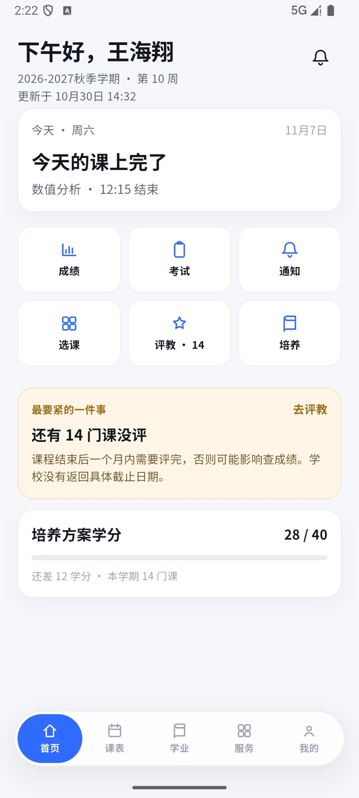
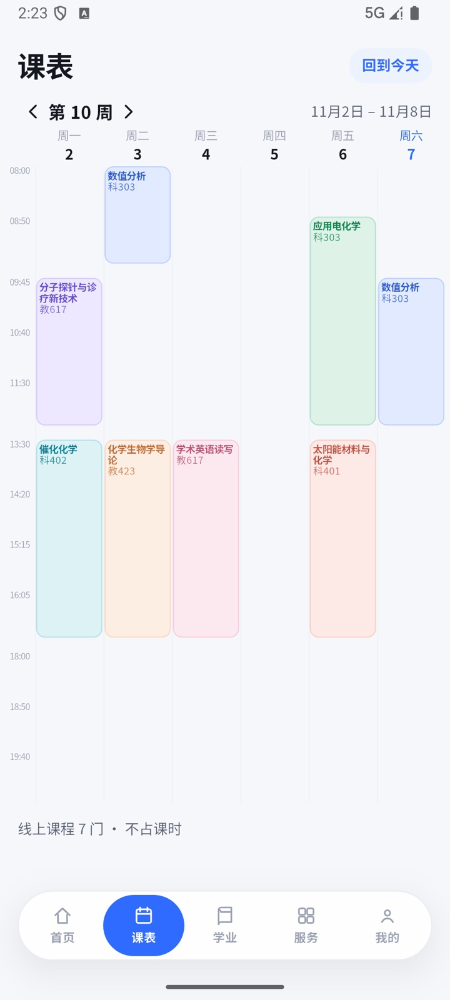
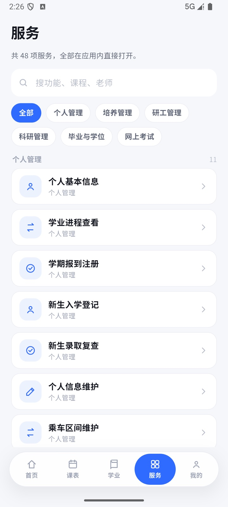
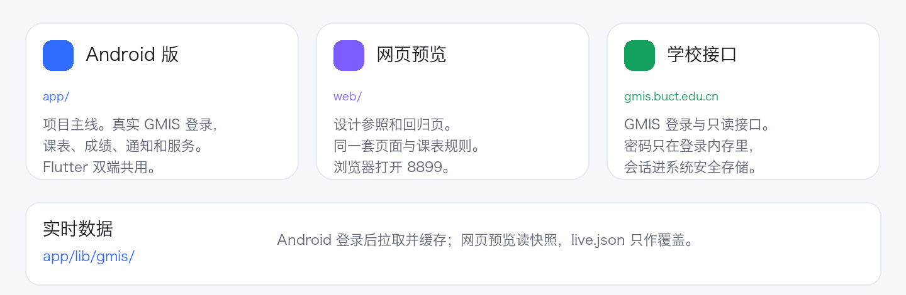
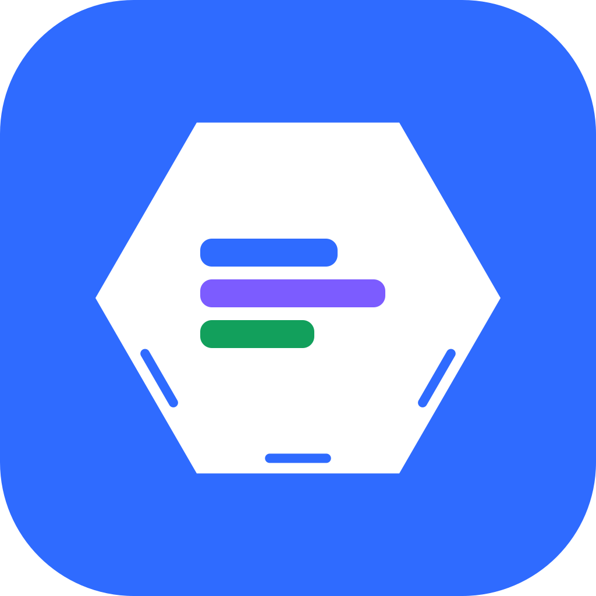

<p align="center">
  
</p>

<h1 align="center">化研助手</h1>

<p align="center">北京化工大学研究生管理系统的移动层。<br>课表、培养进度和办事入口先在手机上读清。密码不离开自己的设备。</p>

**Android 版在 `app/`，是项目主线。** `web/` 保留为 390px 可点击设计预览和回归参照，不再承担功能主线。Android 版已经接入真实 GMIS 登录和只读数据：验证码、课表、已选课、成绩、评教、通知、考场和服务菜单都从学校接口读取，登录会话存系统安全存储，课表快照缓存在本机。界面按 5 Tab（首页/课表/学业/服务/我的）重排，48 项服务在应用内扁平直达，不经过系统浏览器。校外无法解析 `gmis.buct.edu.cn` 时，登录页提供「使用网页版 VPN 登录」，在应用内打开 `w.buct.edu.cn` 完成统一身份认证后继续。选课提交/退选、后台提醒和深色模式仍未做。

## 界面

下面是 Android 版实机截图。首页、课表、学业、服务、我的使用 5 Tab；服务是 48 项扁平目录，全部应用内打开；长课名在课表格子里折行。

<table>
  <tr>
    <td align="center"></td>
    <td align="center"></td>
    <td align="center"></td>
  </tr>
  <tr>
    <td align="center">首页</td>
    <td align="center">周课表</td>
    <td align="center">服务</td>
  </tr>
</table>

选课列表已经是真实数据但只读；选课三屏、提交/退选和考试倒计时还没有设计稿。

## 三块怎么接在一起



Android 版通过 `app/lib/gmis/` 里的 Dart 适配层登录学校接口，把课表和列表装配成快照缓存在本机；`app/assets/snapshot.json` 只用于组件测试和截图，不是默认数据。网页预览仍读 `web/data/snapshot.json`，`gmis_cli.py` 只做可选的只读导出，把 `web/data/live.json` 留给网页预览覆盖。两份仓库内快照都不含密码或 Cookie。

## 标志



外圈是苯环，里面三节颜色不同的课。主色 `#2F6BFF`，另外两节用课程色 `#7C5CFF` 和 `#12A05C`，底色 `#F5F7FA`。标志是自建的，图标里不放校徽。

矢量源文件在 [`design/brand/icon.svg`](design/brand/icon.svg)。改完图形后运行：

```bash
python3 design/brand/render_logo.py
```

这会重写网页图标、Flutter Web 图标，以及 Android、iOS 的启动图标。

## 跑起来

### Android（主线）

本机装好 Flutter 3.47 和 Android SDK 后：

```bash
cd app
flutter pub get
flutter test
flutter analyze
flutter build apk --debug
```

debug 产物在 `app/build/app/outputs/flutter-apk/app-debug.apk`；打 release 包用 `flutter build apk --release`，产物在 `app/build/app/outputs/flutter-apk/app-release.apk`。正式包还需要在 `app/android/app/build.gradle.kts` 里换成自己的 release 签名密钥；当前 release 仍用模板的 debug 签名。当前源码版本是 `1.2.0+3`，release APK 的 versionCode 为 3；已发布的 [v1.0.0](https://github.com/JackWPP/buct-graduate-helper/releases/tag/v1.0.0) Android 包只用于侧载试装，`v1.1.0` 标签尚无独立 APK。

真实登录需要手机能访问 `gmis.buct.edu.cn`（校园网，或登录页的网页版 VPN `w.buct.edu.cn`），并且需要自己的研究生账号；仓库里没有可用账号。

CI 在 [`.github/workflows/ci.yml`](.github/workflows/ci.yml)：push 和 PR 会跑 `flutter analyze`、`flutter test`、debug APK 构建，以及 Python 和网页课表规则测试。

### 网页预览（设计参照）

```bash
cd web && python3 -m http.server 8899
```

打开 http://127.0.0.1:8899/ 。预览优先读 `web/data/live.json`，没有就继续用 `web/data/snapshot.json`；`live.json` 不提交。

### Python 只读导出

```bash
python3 -m pip install -r requirements.txt
python3 gmis_cli.py login --user 2026201060 --cookies cookies.json
python3 gmis_cli.py timetable --cookies cookies.json
```

登录会把学校返回的验证码图存进临时目录，终端输入 4 位数字后图片即删。密码只从环境变量 `GMIS_PASSWORD` 或交互提示读取。`login` 成功后 Cookie 写入 `cookies.json`（已被忽略）。接口返回 302 时重新执行 `login`。`timetable` 写成 `web/data/live.json`，只供网页预览使用。

云端接着做的约定在 [AGENTS.md](AGENTS.md)。

## 仓库里有什么

| 文件 | 内容 |
| --- | --- |
| `app/` | **项目主线**：Flutter Android/iOS 客户端 |
| `web/` | 390px 可点击的手机网页预览，设计参照和回归页 |
| `gmis_client.py` | Python 客户端：RSA 登录、Cookie、主要接口、ICS |
| `gmis_cli.py` | 命令行：登录、导出、课表 ICS、课程查询 |
| `GMIS_API.md` | 接口文档：登录、培养、选课、课表、成绩、研工、科研、毕业 |
| `API_INDEX.md` | 按 49 个页面分组的接口索引 |
| `PRD.md` | 产品需求 v0.4 |
| `design/` | 设计说明、导出稿和标志 |
| `research/` | 竞品调研和功能-接口对照 |

## Python 调用

```python
from gmis_client import GmisClient

c = GmisClient()
c.login(lambda gif: input("验证码: "), "2026201060", input("密码: "))

print(c.card())                    # 学生信息
print(c.terms()[0])                # 当前学期
print(c.timetable("55"))           # 课表网格
print(c.selected_courses("55"))    # 已选课列表
print(c.grades())                  # 成绩
print(c.course_list(lb="3", rows=20))  # 选课列表
```

课表导入：

```python
from gmis_client import GmisClient, build_ics
c = GmisClient(); c.load_cookies("cookies.json")
open("课表.ics", "w", encoding="utf-8").write(
    build_ics(c.selected_courses("55"), term_start="2026-08-31")
)
```

## 对接学校时要注意

- 登录 RSA 公钥每次 GET `/home/stulogin` 都变，必须从当前页面 `#pubkey` 解析。
- 业务接口的正文是 JSON，`Content-Type` 却是 `text/html`，按文本解析。
- `__SINDEXCOOKIE__` 和 `ASP.NET_SessionId` 一起保存。会话闲置后会 302 到 `/home/stulogin`。
- 选课验证码是 `GET /home/verificationcode?codetype=xkyzm`，和登录验证码 `stucode` 不同。
- `py_kbcx_ew.week` 是当前星期的英文，不是教学周。教学周用 `py_kbcx_yw` 的 `ksz` / `jsz`。
- 密码、Cookie、验证码、证件号、电话、住址、邮箱不进代码、快照、文档或提交。

## 文档

- [PRD.md](PRD.md)
- [design/02-handoff.md](design/02-handoff.md)
- [GMIS_API.md](GMIS_API.md)
- [API_INDEX.md](API_INDEX.md)
- [gmis_client.py](gmis_client.py)
- [gmis_cli.py](gmis_cli.py)
