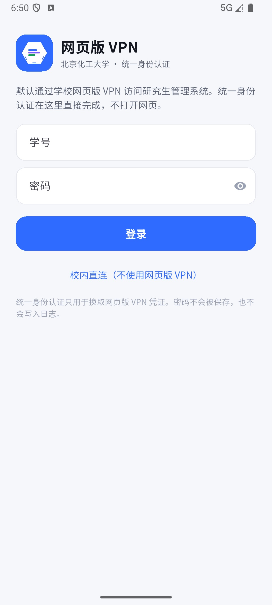

<p align="center">
  
</p>

<h1 align="center">化研助手</h1>

<p align="center">
  把北化研究生的课表、成绩、培养进度和 49 项办事入口，收进一部手机。
</p>

<p align="center">
  <b>Android 主线</b> · <b>Flutter</b> · <b>真实 GMIS 数据</b> · <b>5 Tab</b> · <b>49 项服务</b>
</p>

---

## 一分钟了解

化研助手是北京化工大学研究生管理系统的移动增强层。它不重做学校系统，而是把每天要看的课表、成绩、考试、通知和办事入口整理成一部更顺手的手机应用。

- **打开就看今天**：首页直接显示当前教学周、今日课程、下一节课、评教提醒和培养进度。
- **课表像手机应用，不像网页**：周视图、左右滑换周、长课名折行、课程详情、提醒、ICS 分享。
- **49 项服务一个入口**：搜索、分组筛选，点开即用，不跳系统浏览器。
- **真实数据，真能登录**：默认网页版 VPN + 原生统一身份认证（含短信二次认证）+ GMIS 验证码登录。
- **选课可以直接完成**：二次确认 + 选课验证码，提交后刷新课表与学分。

## 界面

<table>
  <tr>
    <td align="center"></td>
    <td align="center"></td>
    <td align="center"></td>
  </tr>
  <tr>
    <td align="center">首页：今天要做什么</td>
    <td align="center">课表：一周一张表</td>
    <td align="center">服务：49 项一个入口</td>
  </tr>
</table>

<p align="center">
  
  <br>
  <sub>默认通过学校网页版 VPN，统一身份认证在应用内完成</sub>
</p>

## 现在能做什么

| 场景 | 体验 |
| --- | --- |
| 看今天 | 首页显示当前教学周、今日课程、下一节课、评教提醒、培养进度 |
| 看课表 | 周视图、左右滑/箭头换周、课程详情、单课提醒、ICS 分享 |
| 看学业 | 培养进度、成绩、已修课程、评教、考试与调课、申请列表 |
| 办事 | 49 项服务扁平目录，搜索 + 分组筛选，全部应用内打开 |
| 登录 | 网页版 VPN → 原生统一身份认证（含短信二次认证）→ GMIS 验证码 |
| 选课 | 筛选、余量/冲突提示、二次确认、选课验证码、提交/退课 |
| 离线 | 本机快照缓存；有会话时先显示缓存再刷新 |
| 我的 | 个人资料、培养进度、申请、成绩单、设置、退出登录 |

## 产品状态

| 项目 | 状态 |
| --- | --- |
| 当前版本 | `1.6.0+7` |
| 主线 | Android / Flutter；iOS 共用代码，尚未出包 |
| 业务页面 | 全原生；WebView 仅保留为 WebVPN 认证页兜底 |
| 登录 | 网页版 VPN + 原生统一身份认证（含短信 2FA）+ GMIS 验证码 |
| 数据 | 真实 GMIS 接口；快照缓存，登录 Cookie 存系统安全存储 |
| 选课 | 可提交/退课（二次确认 + 选课验证码） |
| 尚未完成 | 后台提醒、深色模式、正式 release 签名、iOS 打包、部分复杂服务表单 |

## 快速开始

### Android

```bash
cd app
flutter pub get
flutter test
flutter analyze
flutter build apk --debug
```

debug APK 在 `app/build/app/outputs/flutter-apk/app-debug.apk`；release 构建与签名说明见 [开发与构建](docs/development.md)。

### 网页预览

```bash
cd web && python3 -m http.server 8899
```

打开 http://127.0.0.1:8899/ 。`web/` 是 390px 设计预览，不是功能主线。

## 文档导航

| 文档 | 内容 |
| --- | --- |
| [产品说明](docs/product.md) | 为什么做、给谁用、核心体验、页面地图、产品边界 |
| [架构与数据流](docs/architecture.md) | App / 网页 / Python 三块关系、登录链路、缓存与会话 |
| [开发与构建](docs/development.md) | 环境要求、Android/网页/Python 命令、测试、CI、目录结构、排障 |
| [学校接口笔记](docs/gmis-notes.md) | GMIS 登录、WebVPN/SSO、课表、选课、成绩等接口注意事项 |
| [路线图与限制](docs/roadmap.md) | 当前版本、已上线、下一步、已知限制、验证基线 |
| [PRD](PRD.md) | 完整产品需求 |
| [设计交接](design/02-handoff.md) | 页面结构、交互规则、设计前提 |
| [文档导航](docs/README.md) | 全部文档入口 |

## 安全边界

- 密码只用于当次登录，不写入偏好、快照或日志。
- 登录 Cookie 只进系统安全存储。
- 快照只保留课表和培养进度需要的学业字段。
- 仓库不包含学校账号、Cookie、验证码、证件号、电话、住址或邮箱。

---

<p align="center">
  <sub>化研助手是学生自建项目，不是北京化工大学官方产品。学业数据以学校 GMIS 为准。</sub>
</p>
