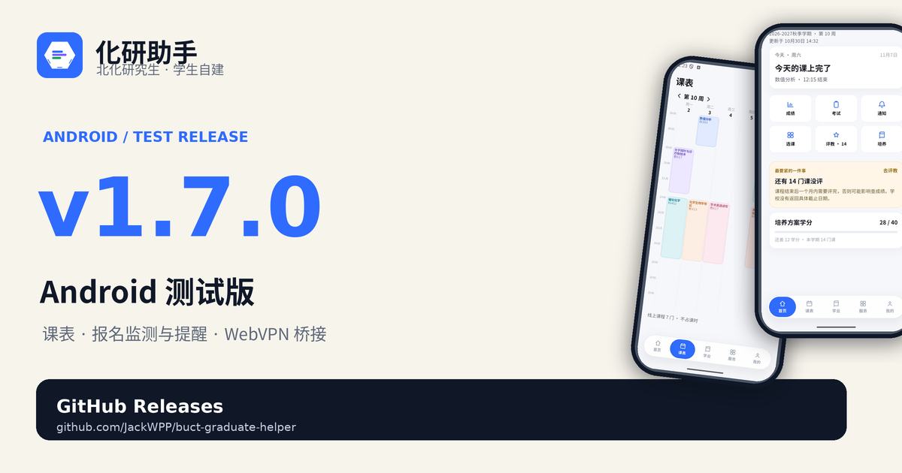

# 化研助手 1.7.0

> Android 测试版 · 2026-11-08

  

这是化研助手把「学术报告 / 劳动实践」做成完整流程的一版：可报名活动、我的报名、详情、报名/取消、独立验证码、自动监测和本地提醒都能在应用内完成；同时把登录、刷新和日常交互再打磨了一轮。

## 这版有什么

- **学术报告 / 劳动实践全流程**：可报名列表、我的报名、活动详情、报名/取消、独立 `VeriCode` 验证码；劳动实践页显示累计劳动小时。
- **自动监测与提醒**：登录后每 30 秒轮询可报名列表，发现新活动发本地通知和全局提示；为报名开始/截止、活动开始安排本地提醒。
- **登录更顺**：统一身份认证成功后，学号/密码只在内存中预填到 GMIS 登录页，用户只补图形验证码；保存 WebVPN ticket，重启可复用会话。
- **启动与恢复**：启动骨架屏、缓存优先展示、会话过期不白屏并回到原 Tab；全局反馈组件统一 SnackBar 样式。
- **日常交互**：首页/课表/学业/服务/我的支持下拉刷新，显示更新时间和离线提示；课表新增周选择器；服务搜索可清除；空态和远程页支持重试。
- **稳定性**：课表周选择器布局修复；全局动效尊重系统「减少动态效果」设置。

## 安装

- 下载下方 `huayan-1.7.0.apk`。
- 支持 Android 8.0 及以上（minSdk 24）。
- 如果手机里已有旧版本，直接覆盖安装即可；若系统提示签名不同，请先卸载旧版再安装（卸载会清除本机偏好和缓存）。
- 本版仍是**测试版**，使用 Android debug 签名，仅用于体验和内部测试，不要用于正式分发。

## 登录

1. 首次打开先看引导页，完成后进入网页版 VPN 登录。
2. 输入研究生学号和密码；学校要求时输入短信验证码。
3. 进入 GMIS 登录页时学号已自动带入（SSO 成功后密码只在内存中预填），补充图形验证码即可。
4. 登录后自动加载首页、课表和服务目录。

校外默认走 `w.buct.edu.cn`。校园网内可用 `--dart-define=DIRECT_GMIS=true` 构建校内直连版本。

## 验证情况

- `flutter analyze`：无问题
- `flutter test`：62 个测试全部通过
- `flutter build apk --release`：成功，versionName `1.7.0` / versionCode `8`，约 59.8 MB
- 真机 `M531DA`（Android 17）活动页实测：学术报告真实返回 6 个可报名活动、劳动实践 5 个，劳动累计小时正常显示；首页活动入口、活动详情和报名入口正常。

## 已知限制

- 活动自动监测目前只在应用进程运行期间生效；系统级后台常驻、通知设置页和免打扰规则尚未完成。
- 本地通知只针对已知活动安排；应用完全退出后不会继续探测新活动。
- 深色模式还未做，界面固定浅色。
- 新生入学登记、录取复查、照片核对、学年鉴定等复杂表单仍是只读/占位页，后续继续补。
- release 签名目前仍是模板 debug 签名，正式分发前需要更换正式密钥。
- iOS 共用 Flutter 代码，但还没有打可分发的包。

## 文档

- [README](https://github.com/JackWPP/buct-graduate-helper/blob/main/README.md)
- [产品说明](https://github.com/JackWPP/buct-graduate-helper/blob/main/docs/product.md)

## 校验

SHA-256：`be5571fa5d0ab366c4c009b72917913ed69a1f340a959c56fa212d7cc0cac42b`

---

化研助手是学生自建项目，不是北京化工大学官方产品。学业数据以学校 GMIS 为准。
