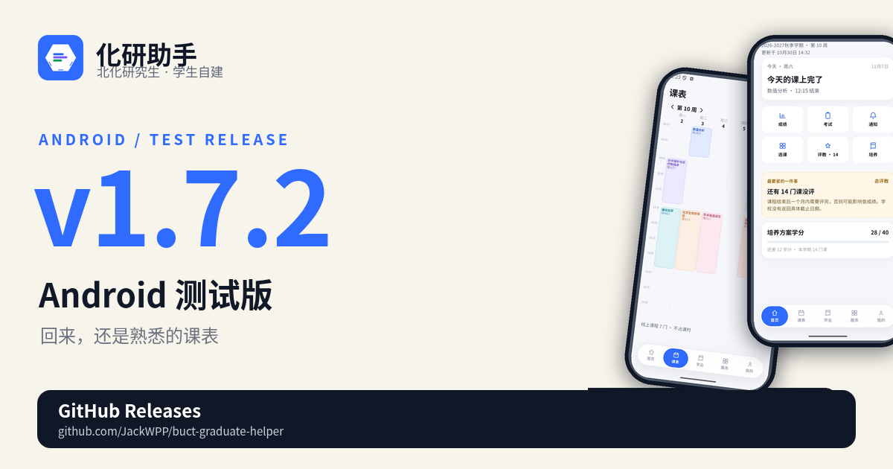
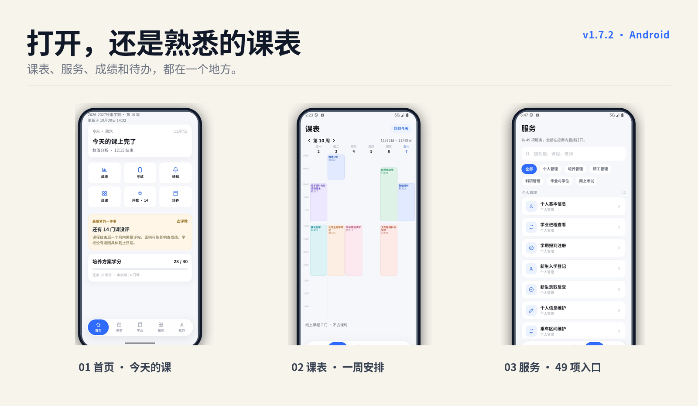

# 化研助手 1.7.2

> Android 测试版 · 2026-11-11

  

这一版没有大改界面，重点放在“回来”的体验：不用反复退出重登，打开应用就能继续看今天的课、待办和服务。

  

## 打开就能继续

- **首页还是今天**：当前周次、今日课程、下一节课、评教提醒和培养进度，打开就能看到。
- **课表直接翻**：周视图左右滑，课程时间、教室和线上课都标在表里。
- **服务不用找**：49 项研究生服务收在一个入口，搜索、筛选、点开就用。
- **登录少折腾**：学校会话会在后台尽量续上；就算需要重新登录，学号和密码也会提前带好，不用从头填一遍。
- **随时可清除**：密码可以选择不保存；保存了也能在设置里一键清除，退出登录会一起清掉。

## 下载

- 下载下方 `huayan-1.7.2.apk`。
- 支持 Android 8.0 及以上（minSdk 24）。
- 覆盖安装即可；如果系统提示签名不同，需要先卸载旧版。
- 这一版仍是**测试版**，使用 Android debug 签名，适合体验和内部测试，不要用于正式分发。

## 关于数据

化研助手是学生自建项目，不是北京化工大学官方产品；课表、成绩、考试和通知都以学校 GMIS 为准。

---

  化研助手 · 北京化工大学研究生管理系统移动增强层

