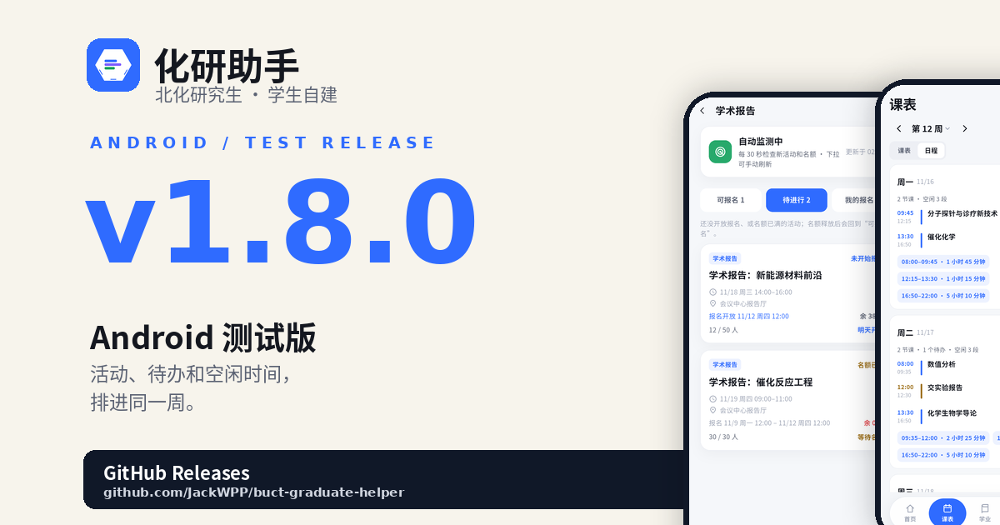
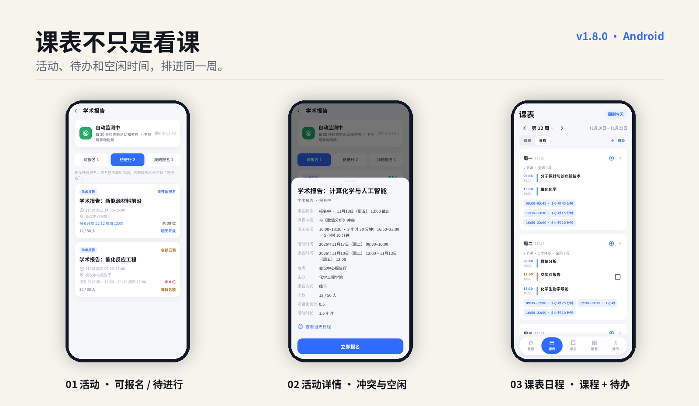

# 化研助手 1.8.0

> Android 测试版 · 2026-11-11

  

这一版把“看活动”和“看课表”连在了一起：报名前先知道会不会撞课、当天还有没有空，报名之后也能把活动、待办和课程放在同一张周日程里。

  

## 这版能做什么

- **活动分成三栏**：可报名、待进行、我的报名。还没开放的活动放进“待进行”，能看到几点开放；名额满了的活动也会留在这里，等有人退报再回来。
- **报名前先看课表**：活动卡片和详情都带周几；详情直接标出与哪门课冲突、当天哪些时段空着，还能打开当天日程看完整安排。
- **课表多了“日程”视图**：一周里同时看到课程、已报名活动和待办，自动算出每段空闲时间；点某一天可以看当天详情。
- **待办能按课程时间记**：新增/编辑/勾选完成/删除；从课程行添加时会带好上课日期和时间，也可以直接记一条自己的事。
- **待办只存在本机**：按学号隔离，不上传学校系统；换设备或卸载应用不会同步。
- **活动和名额继续自动盯**：应用打开时发现新活动、报名开始或名额释放会提醒；名额满了的活动重新有空位时会回到“可报名”。

## 下载

- 下载下方 `huayan-1.8.0.apk`。
- 支持 Android 8.0 及以上（minSdk 24）。
- 覆盖安装即可；如果系统提示签名不同，需要先卸载旧版。
- 这一版仍是**测试版**，使用 Android debug 签名，适合体验和内部测试，不要用于正式分发。

## 校验

- APK：`huayan-1.8.0.apk`
- SHA-256：`d1d3216322329deaf64e995adcb2e5d9995b72a8b321734282a687bde9da9740`

## 关于数据

化研助手是学生自建项目，不是北京化工大学官方产品；课表、活动、成绩和通知都以学校 GMIS 为准。个人待办只保存在本机。

---

  化研助手 · 北京化工大学研究生管理系统移动增强层

