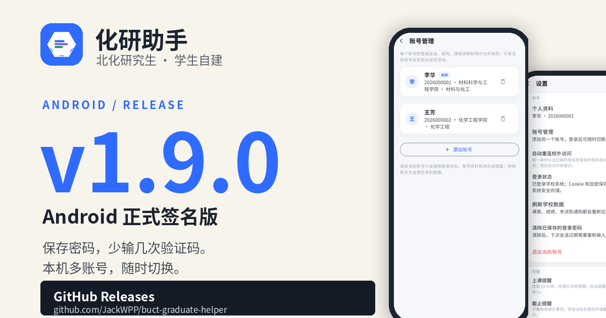
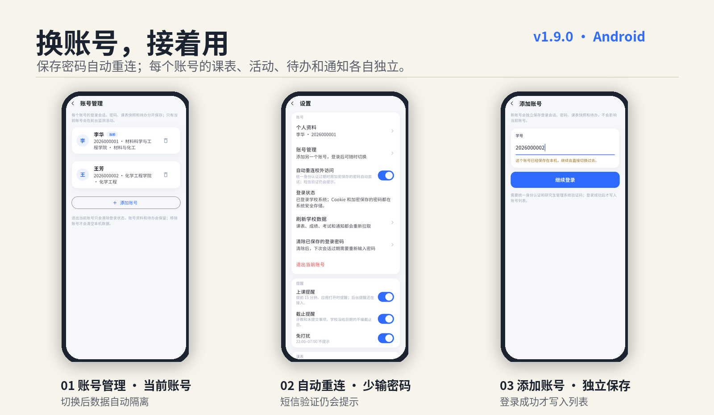

# 化研助手 1.9.0

> Android 正式签名版 · 2026-11-15

  

这一版把登录和账号做得更省心：保存一次密码，之后过期时少输一次；一台手机里可以放多个账号，切换后课表、活动和待办各自独立。

  

## 这版能做什么

- **登录更省事**：勾选保存密码后，统一身份认证过期会自动尝试重连；成功直接回首页，失败停在预填页，不会反复试。
- **验证码只补一次**：研究生管理系统会话过期时，学号和密码已经预填，只需要输入图形验证码。
- **自动重连可关闭**：设置里可以随时关闭“自动重连校外访问”；需要短信验证时仍会提示。
- **本机多账号**：可以保存多个账号并快速切换；每个账号的登录状态、课表、活动、待办和通知各自独立。
- **退出不丢资料**：退出当前账号只清登录状态，账号资料和本机待办保留；“移除账号”才会清空该账号的本机数据。
- **正式签名**：从这一版起使用正式 release 签名。

## 下载

- 下载下方 `huayan-1.9.0.apk`。
- 支持 Android 8.0 及以上（minSdk 24）。
- **从 v1.8.0 及更早版本升级**：这些版本使用测试签名，首次安装 1.9.0 需要先卸载旧版再安装。卸载会清除本机登录状态、待办和缓存，学校系统里的数据不受影响；从 1.9.0 起，后续同签名版本可以正常覆盖升级。

## 校验

- APK：`huayan-1.9.0.apk`
- SHA-256：`47d3074bf1662f364b511e82f6f3aa8aa5382d12749d7695fba60f932859e54c`

## 关于数据

化研助手是学生自建项目，不是北京化工大学官方产品；课表、活动、成绩和通知都以学校 GMIS 为准。个人待办只保存在本机。

---

  化研助手 · 北京化工大学研究生管理系统移动增强层

